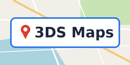

# 3DS Maps



**3DS Maps** turns a Nintendo 3DS into a GPS navigator. It uses your **phone as
the GPS**: the phone sends its location over Wi-Fi, and the 3DS shows an
OpenStreetMap map with a live blue dot for where you are.

* Scrollable, zoomable OpenStreetMap map on the top screen, downloaded through
  your phone's hotspot and saved to the SD card so places you've seen work offline.
* Touch-screen menu on the bottom screen: search for a place, pick **car** or
  **walking**, and tap **Go**.
* Turn-by-turn directions with arrows, distance to the next turn, time left and
  arrival time. If you go off the route, it finds a new one.
* Works with the free Android app **Share GPS** (recommended, see
  [setup](#android-share-gps-recommended)), any app that sends NMEA GPS data,
  or just Chrome on the phone.

```
 phone (GPS)  --Wi-Fi hotspot-->  3DS
   sends NMEA position              shows map + dot
                                    downloads map tiles through the hotspot
                                    (or uses tiles already on the SD card)
```

## What you need

* A 3DS with custom firmware and the Homebrew Launcher.
* A phone with a Wi-Fi hotspot. The 3DS only does **2.4 GHz** Wi-Fi with WPA2:
  * iPhone: Settings → Personal Hotspot → turn on **Maximize Compatibility**.
  * Android: hotspot settings → AP band **2.4 GHz**.

## Install

### With FBI (scan the QR code)


1. Connect the 3DS to the internet (your phone's hotspot works).
2. Open **FBI** → **Remote Install** → **Scan QR Code**.
3. Point the 3DS camera at this QR code and confirm. FBI downloads and installs
   the latest `3dsmaps.cia`.
4. **3DS Maps** now has its own icon on the HOME Menu.

The QR code always points at the newest release:
`https://github.com/cesarg3204-boop/3ds-maps-gps/releases/latest/download/3dsmaps.cia`

### Homebrew Launcher (.3dsx)

1. Download `3dsmaps.3dsx` from the
   [latest release](https://github.com/cesarg3204-boop/3ds-maps-gps/releases/latest)
   and copy it to `SD:/3ds/3dsmaps/3dsmaps.3dsx`.
2. Open **3DS Maps** from the Homebrew Launcher.

### After installing

* Connect the 3DS to your phone's hotspot (System Settings → Internet Settings).
* The first run creates `SD:/3ds/3dsmaps/config.ini`; you don't need to edit it.
* Optional: copy a `tiles` folder to `SD:/3ds/3dsmaps/tiles` for offline maps
  (see "Offline maps" below).

## Sending the phone's GPS

The 3DS accepts location three ways at the same time: from a web page in the phone's browser (port **8080**, see Android below), and as standard **NMEA 0183** GPS sentences:

* **UDP push** – the phone sends to the 3DS on port **10110**
  (the 3DS IP is shown on the bottom screen).
* **TCP pull** – the 3DS connects to an NMEA server on the phone
  (`phone_ip=auto` finds the phone on its hotspot; ports `11123` and `50000` are tried).

### Android: Share GPS (recommended)

[**Share GPS**](https://play.google.com/store/apps/details?id=com.jillybunch.shareGPS)
is a free Android app that shares the phone's GPS over Wi-Fi and keeps running
with the screen off. It's the easiest way to use 3DS Maps on the go.

**One-time setup**

1. Install **Share GPS** from Google Play and allow location access.
2. In Share GPS, tap **Add** to create a connection:
   * Connection type: **TCP/IP**
   * **Server mode: on** (the 3DS connects to the phone)
   * Port: leave the default, **50000**
   * Give it any name, for example `3DS`, and save.
3. In Android settings → Apps → Share GPS → Battery, choose **Unrestricted**,
   so Android doesn't stop it when the screen turns off.
4. Turn on the phone's **Wi-Fi hotspot** with the band set to **2.4 GHz**, and
   connect the 3DS to it once (System Settings → Internet Settings →
   Connection Settings → Search for Access Point).

**Every time**

1. Turn on the hotspot.
2. In Share GPS, start the `3DS` connection.
3. Open 3DS Maps. It finds the phone by itself: tap **Info** and the Phone line
   turns green and says `connected`. The blue dot appears once the phone has a fix.

**If it says "waiting for phone"**

* Make sure the 3DS is on the phone's hotspot, not on another Wi-Fi network.
  The phone's hotspot screen should list it as a connected device.
* Check that the Share GPS connection is running (its notification is showing).
* Tap **Info → Phone IP** and type the phone's IP address on the hotspot, or
  `auto` to go back to automatic. It is saved for next time.
* Running 3DS Maps in an emulator on the same phone? `auto` also tries
  `127.0.0.1`, so no change is needed.

### Android without an app (Chrome)

The 3DS serves a small web page. Chrome on the phone reads your GPS and sends it to the 3DS.

1. Open 3DS Maps. The bottom screen shows **On phone open: http://<3DS IP>:8080**.
2. One-time Chrome setup. Chrome only gives location to "secure" pages, so allow this one:
   open `chrome://flags/#unsafely-treat-insecure-origin-as-secure`, type the address
   from the 3DS screen (for example `http://192.168.43.57:8080`) in the box,
   set it to **Enabled**, and tap **Relaunch**.
3. Open that address in Chrome, tap **Start sending GPS**, and allow location.
4. Keep the page open with the screen on. The 3DS bottom screen shows **FIX**.

The hotspot can give the 3DS a different IP next time. If the page won't load,
check the address on the 3DS screen and update the Chrome flag if it changed.

This only works while the page is open with the screen on, so Share GPS is
better for real trips. Other Android options: an NMEA-over-UDP app pointed at
the 3DS IP, port `10110`, or the Termux script `phone/phone_gps_sender.py`.

### iPhone

iOS can't run scripts like Termux, so use an app that serves NMEA over the
network, for example **GPS2IP**. Set it to TCP/socket mode on port `11123` and
start it; with the iPhone hotspot on, 3DS Maps connects to it automatically
(`phone_ip=auto` → `172.20.10.1`). If your app uses another port, change
`tcp_port` in `config.ini`. Keep the app in the foreground or allowed to run
in the background.

## Using the app

The **top screen** is the map. The **bottom screen** is a touch screen:

* **Home**: a big **Where to?** button, a **Car / Walk** switch, **Follow me**,
  zoom **- / +**, and **Info**.
* **Results**: places as cards (tap to see one on the map, arrows to scroll),
  the Car / Walk switch, and a green **Go** button.
* **Navigating**: the next turn with a big arrow and the distance to it, the
  turn after that, distance and time left, and the arrival time. Buttons:
  **End**, **Car/Walk** (switching gets a new route), **New** search.
* **Info**: GPS details, the 3DS IP, the phone connection, the phone page
  address, tile status, and the tiles online/offline switch.

Buttons still work too:

| Button | Action |
|---|---|
| Circle Pad / D-Pad | Move the map (stops following) |
| R / ZR, L / ZL | Zoom in / out |
| A | Follow GPS (on results: Go) |
| X | Search |
| Y | On results: switch Car / Walk |
| B | Back |
| SELECT | Tile downloading on/off |
| START | Quit (remembers where you were) |

## Search and directions

Tap **Where to?** (or press X), type where you want to go (an address, a
street, or a place like "Prado Museum"), and press Search. Results near you come
first and show as numbered pins on the map. Tap one, pick Car or Walk, and tap
**Go**.

While navigating, the top of the map shows the next turn with an arrow and the
distance to it, and the bottom screen shows the turn after that plus the
distance and time left. The route is redrawn from where you are if you go off
it for a few seconds. Press **B** to end the route.

Search and directions need internet (through the phone hotspot). They use the
free OpenStreetMap services Nominatim (search) and OSRM on routing.openstreetmap.de
(routes, by FOSSGIS). Please use them gently: no automated or bulk requests.

## Map tiles

Tiles are stored as `SD:/3ds/3dsmaps/tiles/{z}/{x}/{y}.png` (256×256 PNG).
With `online=1` the 3DS downloads the tiles you look at through the hotspot
(about 10–30 KB each, uses phone data) and saves them, so places you have
viewed once work offline afterwards.

### Offline maps

`tools/download_tiles.py` (Python 3, no extra packages) fetches an area on a PC:

```
python3 download_tiles.py --lat 40.4168 --lon -3.7038 --radius 1 --zoom 14-16
```

Then copy the `tiles` folder to `SD:/3ds/3dsmaps/tiles`.

**OpenStreetMap usage policy:** OSM's tile servers are donated and their
policy forbids bulk downloads (more than ~250 tiles for offline use), so the
script stops at 250 tiles for openstreetmap.org. For a bigger offline area,
use a tile provider whose terms allow it (`--url` / `tile_url=`, PNG tiles),
or browse the area once on the 3DS with downloading on. Map data
© OpenStreetMap contributors, shown on screen.

## config.ini

```
web_port=8080          # phone browser page, 0 = off
udp_port=10110
phone_ip=auto          # or the phone's IP, or off
tcp_port=11123
online=1
tile_url=https://tile.openstreetmap.org/{z}/{x}/{y}.png
user_agent=3DSMaps/1.0 (Nintendo 3DS homebrew map viewer)
zoom=15
start_lat=40.41680
start_lon=-3.70380
```

## Testing without going outside

`tools/fake_gps.py <3DS-IP>` on a PC on the same Wi-Fi sends a fake position
walking in a circle.

## Building

Needs devkitPro (devkitARM, libctru, and the 3ds-curl, 3ds-mbedtls, 3ds-libpng,
3ds-zlib portlibs). Easiest with Docker:

```
docker run --rm -v "$PWD":/src -w /src devkitpro/devkitarm make
```

For the `.cia`, run `tools/make_cia.sh` after `make` (needs
[makerom](https://github.com/3DSGuy/Project_CTR) and
[bannertool](https://github.com/Epicpkmn11/bannertool)). The icon, banner and
CIA settings are in `cia/`.

GitHub Actions builds both files on every push. Every push to `main` publishes
them as the release for the version in `VERSION` (for example `v1.0.0`), which is
what the FBI QR code downloads. Bump `VERSION` to start a new release.

PC unit tests (NMEA parser, map drawing, map maths, search/route parsing): `make -C tests`.

Screen previews on a PC (renders every bottom-screen page to PNG): `make -C tests/preview`.

Every push is built by GitHub Actions; download `3dsmaps.3dsx` from the run's artifacts.

## Files

```
source/main.c      app loop, input, overlays, status screen
source/render.c    map drawing into the 3DS framebuffer, Web Mercator maths
source/tiles.c     tile cache, SD loading, background downloader (libcurl)
source/gps_net.c   UDP listener + TCP client for NMEA
source/nav.c       search results, routes, turn instructions, progress
source/nav_net.c   background search/route requests
source/nmea.c      NMEA $xxRMC / $xxGGA parser
source/web_gps.c   phone web page + its position format
source/config.c    config.ini and last position
romfs/cacert.pem   CA certificates for HTTPS tile downloads
phone/             Android (Termux) GPS sender
tools/             PC tile downloader, fake GPS sender
tests/             PC unit tests
```

## About

3DS Maps is a homebrew project that turns a Nintendo 3DS into a GPS navigator,
with the phone in your pocket as the GPS receiver. It is not affiliated with
Nintendo.

* Map data © [OpenStreetMap](https://www.openstreetmap.org/copyright) contributors.
* Place search by [Nominatim](https://nominatim.org/), routes by
  [OSRM](https://project-osrm.org/) on routing.openstreetmap.de (FOSSGIS).
  These are free community services, so please use them gently.
* Built with [devkitPro](https://devkitpro.org/) (devkitARM, libctru) plus curl,
  mbedTLS, libpng, zlib and jansson.

Bugs and ideas are welcome in [Issues](https://github.com/cesarg3204-boop/3ds-maps-gps/issues).
